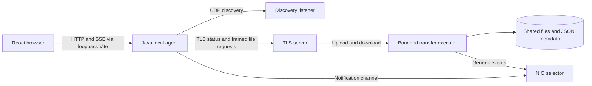

# Architecture

The agent owns one selected server and display name in memory. The connection opens after a successful TLS status exchange. A monitor checks status periodically and clears connection state after three consecutive failures. Each subsequent TCP request performs a TLS handshake with the configured truststore, endpoint identity and a leaf validity check. Java TLS may resume a previously established session. The agent clears the verified indicator after a failed status probe. The agent reconnects its separate NIO subscription while the server connection remains selected.

The central server handles TLS request intake with bounded concurrency. Status and list requests complete during intake. Uploads and downloads are handed to a fixed-size executor with a bounded queue. Shared file metadata is indexed concurrently. The server stages uploads before verification and publication. The agent stages downloads locally so failed verification cannot produce a browser download.

The notification service tracks connections using a single selector and independent bounded outgoing queues. The online count reflects open notification channels. The local agent forwards recognized events over SSE. React reports the channel as live when the agent's NIO connection and the browser's EventSource are both open. File and transfer status refresh independently. Display names remain in the client agent and are absent from TCP, discovery, and notification payloads.

The loopback agent validates the Host and Origin headers and requires a non-simple request header on POST. Browser calls through Vite use the same origin. The event stream is bounded and retains recent browser activity only in memory. The shared store enforces per-file limits and server concurrency limits. Total retained disk usage is controlled operationally.
